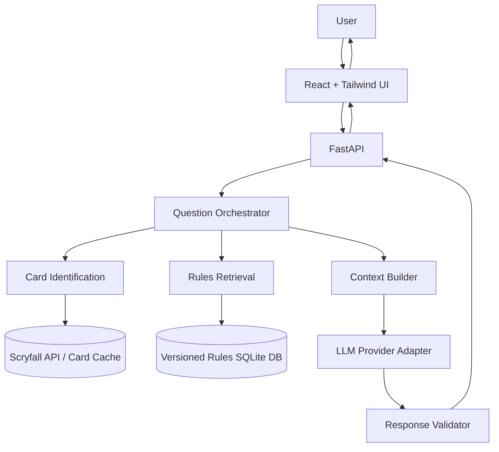

# Scry-X-AI — Technical Specification

**Product:** Scry-X-AI  
**Release:** MVP 1 — Rules Assistant  
**Document status:** Draft for implementation  
**Last updated:** 2026-11-21  
**Companion document:** `PRD.md`

## 1. Purpose

This specification translates the MVP 1 product requirements into an implementable technical design. It defines the system boundaries, architecture, data model, API contracts, retrieval and answer-generation workflow, validation rules, testing strategy, and deployment requirements.

The implementation should prioritize a small, testable, evidence-grounded system. Do not introduce a vector database, agent framework, microservices, or a full MTG rules engine unless an explicit requirement and evaluation evidence justify the added complexity.

## 2. Technology choices

| Layer | Proposed technology | Notes |
|---|---|---|
| Frontend | React + TypeScript | TypeScript is recommended for API/UI contracts |
| Styling | Tailwind CSS | Responsive chat and reference panels |
| Backend | Python + FastAPI | Modular monolithic API |
| Validation | Pydantic | Request/response schemas |
| HTTP client | httpx | Scryfall and source retrieval |
| Initial database | SQLite | Read-heavy rules/card cache for local MVP |
| Rules search | SQLite FTS5 + structured lookup | Start with lexical retrieval |
| Cache | In-process TTL cache initially | Cache external card lookups; do not treat as durable |
| LLM | Provider-agnostic adapter | Model/provider configured through environment variables |
| Tests | pytest + httpx TestClient | Unit and API/integration tests |
| Frontend tests | Vitest + React Testing Library | Component and interaction tests |
| Hosting | Vercel | React frontend and Python FastAPI function, subject to current runtime limits |
| CI | GitHub Actions | Lint, type-check, tests, build |

### Architecture decision
Use a modular monolith: one FastAPI application with clearly separated modules. This is simpler to develop, test, and deploy than independently deployed microservices.

### Persistence decision
SQLite is acceptable for the MVP if it is treated as a read-only or deployment-packaged rules dataset and/or a local development database. Do not assume writes to a Vercel function's local filesystem persist across invocations or deployments.

For durable user data or frequently updated shared data, use a managed database in a later iteration. For MVP rules refreshes, build and validate a new database artifact, then deploy it with the application or use an external persistent store.

## 3. High-level architecture



### Main request flow
1. Frontend submits a question.
2. Backend validates the request.
3. Card identification extracts candidate names and queries Scryfall.
4. If card selection is ambiguous, backend returns candidates and pauses answer generation.
5. For confirmed cards, backend retrieves Oracle text and available rulings.
6. Rules retrieval searches the active Comprehensive Rules dataset.
7. Context builder creates a bounded, source-labelled evidence package.
8. LLM generates a structured answer using only the supplied evidence.
9. Response validator checks citation IDs and source references.
10. API returns the answer, cards, citations, and rules dataset version.
11. Frontend renders the answer and reference panels.

## 4. Proposed repository structure

```text
scry-x-ai/
├── frontend/
│   ├── src/
│   │   ├── api/
│   │   ├── components/
│   │   ├── features/
│   │   │   └── chat/
│   │   ├── hooks/
│   │   ├── types/
│   │   └── App.tsx
│   ├── public/
│   ├── package.json
│   └── ...
├── backend/
│   ├── app/
│   │   ├── api/
│   │   │   ├── routes/
│   │   │   └── schemas/
│   │   ├── core/
│   │   │   ├── config.py
│   │   │   └── logging.py
│   │   ├── services/
│   │   │   ├── card_lookup.py
│   │   │   ├── scryfall_client.py
│   │   │   ├── rules_ingestion.py
│   │   │   ├── rules_retrieval.py
│   │   │   ├── context_builder.py
│   │   │   ├── judge_ai.py
│   │   │   └── response_validator.py
│   │   ├── repositories/
│   │   │   ├── card_repository.py
│   │   │   └── rules_repository.py
│   │   ├── models/
│   │   └── main.py
│   ├── data/
│   │   ├── rules.db
│   │   └── ...
│   ├── scripts/
│   │   └── ingest_rules.py
│   ├── tests/
│   │   ├── unit/
│   │   ├── integration/
│   │   └── fixtures/
│   └── pyproject.toml
├── .github/
│   └── workflows/
│       └── ci.yml
├── .env.example
├── .gitignore
├── README.md
├── PRD.md
└── SPEC.md
```

The exact package layout may be adjusted to fit Vercel's Python entry-point requirements, but service boundaries and testability should be preserved. Do not create empty abstractions without a concrete use.

## 5. Configuration and secrets

Use environment variables. Never commit `.env` or real secrets.

Suggested variables:

| Variable | Required | Description |
|---|---|---|
| `LLM_PROVIDER` | Yes | Provider adapter selection |
| `LLM_API_KEY` | Yes | Server-side LLM API key |
| `LLM_MODEL` | Yes | Model identifier |
| `SCRYFALL_USER_AGENT` | Yes | Descriptive application User-Agent |
| `DATABASE_PATH` | Yes | Rules database path |
| `RULES_SOURCE_URL` | For ingestion | Official rules source URL |
| `FRONTEND_ORIGIN` | Yes | Allowed frontend origin for CORS |
| `LOG_LEVEL` | No | Defaults to `INFO` |

`.env.example` must contain placeholders only. Configuration should fail fast with a clear startup error if required variables are missing.

## 6. Data model

The initial database can use SQLite. The schema below is logical; implementation may add indexes and ingestion metadata.

### 6.1 `rules`
| Field | Type | Description |
|---|---|---|
| `rule_id` | TEXT PRIMARY KEY | Official rule identifier, e.g. `305.7` |
| `parent_rule_id` | TEXT NULL | Parent section/rule where applicable |
| `section` | TEXT NULL | Rule section/category |
| `rule_text` | TEXT | Parsed rule text |
| `version_id` | TEXT | Dataset version |
| `updated_at` | TEXT | Ingestion timestamp |

Create an FTS5 virtual table for `rule_id`, `section`, and `rule_text`. Keep it synchronized with the canonical `rules` table.

### 6.2 `rules_versions`
| Field | Type | Description |
|---|---|---|
| `version_id` | TEXT PRIMARY KEY | Internal immutable dataset ID |
| `source_url` | TEXT | Official source URL |
| `source_version_date` | TEXT NULL | Date stated by source, if available |
| `fetched_at` | TEXT | Retrieval timestamp |
| `checksum_sha256` | TEXT | Source/content checksum |
| `status` | TEXT | `staged`, `active`, or `retired` |

Only one dataset should be active at a time.

### 6.3 `cards_cache`
| Field | Type | Description |
|---|---|---|
| `oracle_id` | TEXT PRIMARY KEY | Scryfall Oracle ID |
| `name` | TEXT | Card name |
| `type_line` | TEXT NULL | Card type line |
| `mana_cost` | TEXT NULL | Mana cost |
| `oracle_text` | TEXT NULL | Oracle text |
| `image_uri` | TEXT NULL | Suitable card image URI |
| `scryfall_id` | TEXT | Scryfall card ID |
| `source_updated_at` | TEXT NULL | Provider timestamp if supplied |
| `fetched_at` | TEXT | Local retrieval timestamp |

A card may have multiple printings. Prefer Oracle ID as the logical card identity while retaining Scryfall ID for the specific returned record.

### 6.4 `rulings_cache`
| Field | Type | Description |
|---|---|---|
| `ruling_id` | TEXT PRIMARY KEY | Stable local/provider identifier |
| `oracle_id` | TEXT | Related card |
| `published_at` | TEXT NULL | Ruling publication date |
| `comment` | TEXT | Ruling text |
| `fetched_at` | TEXT | Local retrieval timestamp |

If the provider does not supply a stable ruling ID, derive a deterministic local key from Oracle ID, date, and normalized comment. Do not claim that this is a provider-issued identifier.

## 7. Card identification and lookup

### Inputs
- Raw user question.
- Optional user-confirmed card identifiers from the UI.

### Processing
1. Normalize whitespace and punctuation without changing meaningful card-name characters.
2. Detect candidate card names using a lightweight extraction strategy:
   - First pass: match known card names/aliases against the question.
   - Second pass: use an LLM or deterministic extraction helper only to propose candidate names, never to establish card identity.
3. Query Scryfall by exact name first.
4. If exact lookup fails, use Scryfall fuzzy lookup.
5. Retrieve candidate details and normalize them into the application's card schema.
6. Score candidates using exactness, normalized name similarity, and context.
7. If one candidate is clearly above the configured confidence threshold, mark it as a suggested match.
8. If multiple candidates are plausible or confidence is low, return an ambiguity response and require user confirmation.

### Important behavior
- Never invent a card or treat an LLM-extracted name as verified.
- A card name mentioned in ordinary prose may not be a card reference; use matching confidence and context.
- User-confirmed cards should be carried into the answer request by stable IDs.
- Do not silently substitute a different printing if it changes relevant characteristics or available data.

### Ambiguity response
Return candidate cards with:
- `scryfall_id`
- `oracle_id`
- `name`
- `type_line`
- `mana_cost`
- `image_uri` when available

The UI should let the user choose the intended card. The answer-generation endpoint must not proceed until required ambiguous matches are resolved.

## 8. Rules ingestion and retrieval

### 8.1 Ingestion
Create a repeatable command, for example:

```bash
python -m app.scripts.ingest_rules --source <official-source-url>
```

The command should:
1. Fetch the configured official source.
2. Store the raw source temporarily.
3. Compute a SHA-256 checksum.
4. Parse rule identifiers and text.
5. Validate that parsing produced a plausible number of rules and expected top-level sections.
6. Insert into a staged dataset/database.
7. Run integrity checks and sample assertions.
8. Mark the new version active only after all checks pass.
9. Preserve the last known-good version if any step fails.

The parser must be tested against a checked-in sanitized fixture representing the source format. Parsing should fail loudly when the upstream document structure changes.

### 8.2 Retrieval
Use a hybrid, explainable retrieval strategy for MVP:
- Exact rule-number lookup when a rule number is mentioned or discovered.
- SQLite FTS5 query over rule text and section names.
- Keyword expansion for known MTG concepts, where useful.
- Retrieval of parent/neighbor rules to preserve context.
- Deduplication and ranking.

Return a bounded set of rule passages, each with:
- Rule ID.
- Rule text.
- Section.
- Rules version ID.
- Source metadata.
- Retrieval score/match reason (internal diagnostic).

Do not rely on a single keyword match for high-impact conclusions. Retrieval quality must be evaluated against the curated test set.

### 8.3 Retrieval limitations
MVP retrieval is lexical and structured, not a complete semantic rules engine. If evidence is missing, the answer must state that limitation. Embeddings may be introduced only after measuring retrieval misses.

## 9. Context construction

The context builder receives:
- Original user question.
- Confirmed cards and their Oracle text.
- Available card-specific rulings.
- Retrieved Comprehensive Rules passages.
- Active rules version and source metadata.

It produces a bounded, source-labelled context object. Each evidence item must have a stable ID for citation validation.

Example internal structure:

```json
{
  "question": "What happens if Blood Moon is on the battlefield with Urza's Saga?",
  "rules_version": {
    "version_id": "cr-2026-11-example",
    "source_version_date": "2026-11-01"
  },
  "cards": [
    {
      "oracle_id": "example-oracle-id",
      "name": "Blood Moon",
      "oracle_text": "..."
    }
  ],
  "rulings": [],
  "rules": [
    {
      "evidence_id": "rule-305-7",
      "rule_id": "305.7",
      "text": "..."
    }
  ]
}
```

The example IDs and text above are illustrative only. Production evidence must come from retrieved data.

## 10. LLM answer generation

### Provider abstraction
Implement a small interface so the provider can be changed without rewriting orchestration:

```python
class LLMClient:
    async def generate_judge_answer(self, *, question: str, context: dict) -> dict:
        ...
```

Use structured output validated by Pydantic. Do not allow the model to return arbitrary HTML.

### System prompt requirements
The judge assistant prompt must instruct the model to:
- Act as a careful MTG rules explanation assistant, not an official judge.
- Base factual claims on supplied card text, rulings, and Comprehensive Rules evidence.
- Distinguish retrieved facts from its explanation of their application.
- Explain the interaction step by step when useful.
- Cite rule IDs for rules-based claims.
- Cite card-specific rulings only when those rulings were actually retrieved.
- Never invent card text, rule numbers, quotations, or rulings.
- Identify missing game-state assumptions.
- Ask for clarification or return insufficient evidence when necessary.
- State when sources appear incomplete or conflicting.
- Avoid claiming certainty beyond the evidence.

### Expected model output
```json
{
  "status": "answered",
  "summary": "Short direct conclusion.",
  "explanation": [
    "Step-by-step explanation grounded in supplied evidence."
  ],
  "assumptions": [],
  "citations": [
    {
      "evidence_id": "rule-305-7",
      "kind": "comprehensive_rule",
      "reason": "Why this rule supports the explanation."
    }
  ],
  "uncertainties": [],
  "clarifying_question": null
}
```

Allowed `status` values:
- `answered`
- `needs_clarification`
- `insufficient_evidence`

The actual output schema should be implemented with Pydantic and strict validation.

## 11. Response validation

The response validator must:
1. Parse model output into the expected schema.
2. Reject unknown status values and malformed fields.
3. Verify every citation `evidence_id` exists in the context package.
4. Verify each Comprehensive Rules citation maps to a rule in the selected rules version.
5. Verify each card-ruling citation maps to a ruling actually retrieved for the answer.
6. Reject or safely downgrade unsupported citations.
7. Ensure the response includes the rules version used.
8. Return a safe error/insufficient-evidence response if validation fails.

Citation validation proves that a cited source exists in the retrieved context; it does not prove that the model's interpretation is correct. Semantic correctness must be evaluated separately using human-reviewed test cases.

## 12. API specification

Prefix: `/api/v1`

### 12.1 `GET /health`
Purpose: Deployment health check.

Response:
```json
{
  "status": "ok"
}
```

Do not expose secrets, filesystem paths, or detailed infrastructure information.

### 12.2 `GET /rules/version`
Purpose: Return active rules dataset metadata.

Response:
```json
{
  "version_id": "cr-2026-11-example",
  "source_version_date": "2026-11-01",
  "fetched_at": "2026-11-21T00:00:00Z",
  "source_url": "https://example.invalid/official-rules"
}
```

Values are illustrative. Production values must come from the active dataset metadata.

### 12.3 `POST /cards/identify`
Purpose: Identify candidate cards in a question.

Request:
```json
{
  "question": "What happens if Blood Moon is on the battlefield with Urza's Saga?"
}
```

Response when resolved:
```json
{
  "status": "resolved",
  "cards": [
    {
      "scryfall_id": "provider-card-id",
      "oracle_id": "provider-oracle-id",
      "name": "Blood Moon",
      "type_line": "Enchantment",
      "mana_cost": "{2}{R}",
      "oracle_text": "...",
      "image_uri": "https://..."
    }
  ],
  "ambiguous": []
}
```

Response when ambiguous:
```json
{
  "status": "needs_selection",
  "cards": [],
  "ambiguous": [
    {
      "mentioned_name": "Candidate name",
      "candidates": []
    }
  ]
}
```

### 12.4 `POST /judge/ask`
Purpose: Run the complete question-answering flow.

Request:
```json
{
  "question": "What happens if Blood Moon is on the battlefield with Urza's Saga?",
  "confirmed_cards": [
    {
      "scryfall_id": "provider-card-id"
    }
  ]
}
```

`confirmed_cards` is optional when all card matches are confidently resolved. When ambiguity remains, return `needs_selection` with candidate details and do not call the LLM.

Answered response:
```json
{
  "status": "answered",
  "summary": "Short direct conclusion.",
  "explanation": [
    "Explanation step."
  ],
  "cards": [],
  "citations": [
    {
      "evidence_id": "rule-305-7",
      "kind": "comprehensive_rule",
      "label": "Comprehensive Rules 305.7",
      "text": "Retrieved rule text.",
      "source_url": "https://..."
    }
  ],
  "rules_version": {
    "version_id": "cr-2026-11-example",
    "source_version_date": "2026-11-01"
  },
  "assumptions": [],
  "uncertainties": [],
  "clarifying_question": null
}
```

Needs-clarification response:
```json
{
  "status": "needs_clarification",
  "summary": "The game state needs one more detail.",
  "explanation": [],
  "cards": [],
  "citations": [],
  "rules_version": {
    "version_id": "cr-2026-11-example",
    "source_version_date": "2026-11-01"
  },
  "assumptions": [],
  "uncertainties": ["The question does not specify ..."],
  "clarifying_question": "Is ...?"
}
```

Insufficient-evidence response follows the same response schema with `status` set to `insufficient_evidence`.

### API error conventions
- `400`: Invalid request.
- `422`: Schema validation failure.
- `429`: Rate limit exceeded.
- `502`: Upstream provider failure.
- `503`: Required rules dataset or AI provider unavailable.
- `500`: Unexpected internal error; return a generic message and log a correlation ID.

Never return API keys, raw stack traces, or internal prompts to the client.

## 13. Frontend requirements

### Main layout
- Header with product name and unofficial-project disclaimer.
- Main chat panel.
- Related cards panel.
- Rules/references panel.
- Responsive stacking or tabs on narrow screens.

### Required UI states
1. Empty state with example questions.
2. Typing/submitting state.
3. Answered state.
4. Card ambiguity selection state.
5. Clarification-needed state.
6. Insufficient-evidence state.
7. Recoverable API/provider error state.

### Answer presentation
- Show the concise conclusion first.
- Show explanation steps beneath it.
- Display relevant cards with image, name, type line, and Oracle text.
- Display rule references with rule number, text, and source link where available.
- Visually distinguish Comprehensive Rules, card Oracle text, and card-specific rulings.
- Show the rules dataset version used.
- Do not present generated content as a verbatim official ruling.

### Accessibility
- Keyboard support for question submission and candidate selection.
- Semantic headings and buttons.
- Visible focus indicators.
- Text labels in addition to color-coded source types.
- Appropriate alternative text for card images.

## 14. Error handling and graceful degradation

| Failure | Expected behavior |
|---|---|
| Scryfall timeout/unavailable | Use valid cached card data if available; otherwise explain card lookup is unavailable |
| Card match ambiguous | Ask user to select; do not generate answer |
| No relevant rules retrieved | Return insufficient evidence or ask a clarification question |
| LLM timeout/unavailable | Return a recoverable error; do not fabricate an answer |
| Invalid model JSON | Retry once with constrained repair if supported; otherwise fail safely |
| Unknown citation ID | Reject/downgrade answer and return safe failure |
| Rules database missing/corrupt | Fail readiness/health check and do not answer rules questions |
| Rules update fails | Keep the previous active dataset |

## 15. Testing strategy

### Unit tests
- Card-name normalization.
- Exact card matching.
- Fuzzy card matching.
- Ambiguity detection.
- Scryfall response parsing.
- Rules document parsing.
- Rules version activation and rollback.
- FTS5 rules retrieval and ranking.
- Context assembly and evidence IDs.
- Pydantic model validation.
- Citation existence and type validation.
- Insufficient-evidence behavior.

### Integration tests
- `/health` and `/rules/version`.
- `/cards/identify` with exact, fuzzy, unknown, and ambiguous inputs.
- `/judge/ask` with mocked Scryfall and LLM providers.
- Provider timeout and malformed-response handling.
- Full pipeline from question to validated cited answer.

### Frontend tests
- Submit question.
- Render answer and citations.
- Render identified cards.
- Resolve ambiguous card selection.
- Render clarification and insufficient-evidence states.
- Handle API errors and loading states.

### Evaluation dataset
Create 30–50 manually reviewed questions with:
- User question.
- Expected card identities.
- Relevant rule IDs.
- Relevant card rulings, if any.
- Expected conclusion or key reasoning points.
- Required assumptions/clarifications.
- Severity if answered incorrectly.

Include examples covering:
- Blood Moon and Urza's Saga.
- Layers and continuous effects.
- Type-changing effects.
- Ability removal/granting.
- Triggered abilities and the stack.
- State-based actions.
- Replacement effects.
- Missing or ambiguous game-state details.

Measure separately:
- Card identification accuracy.
- Retrieval recall for expected rule IDs.
- Citation validity.
- Conclusion/reasoning correctness by human review.
- Unsupported certainty/hallucination rate.

Do not use an LLM judge as the sole evaluator of correctness.

## 16. Security and operational requirements

- Keep all provider keys on the backend.
- Use environment variables and deployment secret settings.
- Add `.env`, `.env.*` (except a committed `.env.example`), local databases with user data, and generated secrets to `.gitignore` as appropriate.
- Configure CORS to allow only the deployed frontend origin(s).
- Apply request-size limits and rate limiting.
- Add reasonable upstream timeouts and bounded retries.
- Avoid logging full prompts or user questions by default if they may contain personal data.
- Add a correlation ID to errors and logs.
- Review provider terms, Scryfall API guidelines, and Wizards of the Coast source usage before public launch.

## 17. Deployment plan

### Local development
- Run React development server.
- Run FastAPI locally.
- Configure CORS for local frontend origin.
- Use a local rules database and mocked provider responses in automated tests.
- Keep `.env` local and untracked.

### Vercel deployment
- Deploy frontend and Python API using a Vercel-supported project layout.
- Confirm Python runtime, dependency packaging, function duration, memory, and bundle-size constraints against current Vercel documentation before implementation is finalized.
- Package the validated, read-only rules database with the deployment if it fits platform limits.
- Do not use function-local writes as durable storage.
- Configure environment variables in Vercel project settings.
- Configure frontend API base URL and backend CORS.
- Verify `/health`, `/rules/version`, card lookup, and a full judge question after deployment.

If the rules database or runtime constraints make a combined Vercel deployment impractical, deploy the frontend on Vercel and host the FastAPI backend on a Python-friendly service. Keep the frontend/backend API contract unchanged.

## 18. CI/CD

GitHub Actions workflow should:
1. Install supported Python dependencies.
2. Run Python lint/format checks.
3. Run backend unit and integration tests.
4. Install frontend dependencies.
5. Run frontend lint and type checks.
6. Run frontend tests.
7. Build the frontend.
8. Fail the workflow if any required check fails.

Deployment should occur only after CI passes. Do not place deployment secrets in repository files.

## 19. Implementation milestones

### Milestone 1 — Project foundation
- Repository and environment setup.
- FastAPI health endpoint.
- React app shell.
- CI baseline.
- Configuration and logging.

### Milestone 2 — Rules data
- Official source acquisition.
- Parser and ingestion script.
- Version metadata and checksum.
- SQLite schema and FTS5 retrieval.
- Parser/retrieval tests.

### Milestone 3 — Card lookup
- Scryfall client.
- Exact and fuzzy lookup.
- Card/ruling normalization and cache.
- Ambiguity handling.
- API and unit tests.

### Milestone 4 — AI answer pipeline
- Context builder.
- Provider adapter.
- Structured response schema.
- Prompt and answer generation.
- Citation validation.
- Evaluation harness.

### Milestone 5 — User interface
- Chat experience.
- Card panel.
- Rules/citation panel.
- Ambiguity and error states.
- Responsive and accessibility checks.

### Milestone 6 — Release validation
- Run 30–50 question evaluation set.
- Fix critical retrieval and citation issues.
- Deploy staging/production.
- Verify secrets, logs, and rate limits.
- Complete README and demo.

## 20. Definition of done

MVP 1 is complete when:
- The complete happy path works from browser question to cited answer.
- Ambiguous cards require user confirmation.
- Every citation resolves to evidence retrieved for that answer.
- The rules dataset is versioned and its active version is returned with answers.
- Insufficient evidence and upstream failures are handled safely.
- Automated tests pass in CI.
- The deployed app passes smoke tests.
- No secrets are exposed in the frontend or Git history.
- Documentation describes setup, ingestion, evaluation, deployment, data sources, and limitations.

## 21. Known limitations

- MVP uses retrieval and LLM reasoning; it is not a formal MTG rules engine.
- FTS/keyword retrieval may miss semantically related rules.
- The model may still misinterpret correctly retrieved rules.
- The quality of answers depends on source freshness, retrieval quality, and the completeness of the question.
- Card-specific rulings may not cover every interaction.
- The app is unofficial and must not claim to provide tournament-authoritative rulings.
